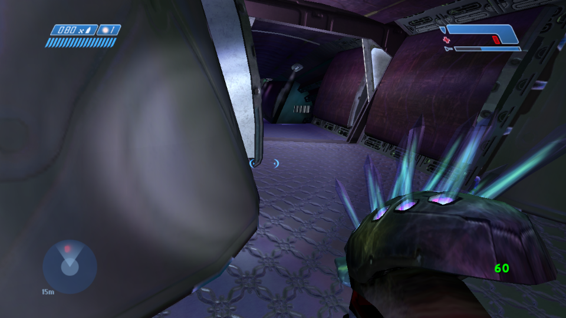

<div align="center">


# OpenCE-WiiU

**Halo: Combat Evolved, running natively on your Wii U.**

[](port/wiiu/PLAYING.md)
[](VALIDATION.md)
[](#online-play)
[](LICENSE)

[**Get started**](#get-it-running) ·
[Windows and Mac setup](#step-2-prepare-your-sd-card) ·
[Controls](#controls) ·
[Questions](#questions-people-ask) ·
[Build it yourself](BUILDING-WIIU.md) ·
[Report a problem](https://github.com/Roastedd/OpenCE-WiiU/issues)


<sub>Captured on a Wii U during development. Maintained by <a href="https://github.com/Roastedd">Roastedd</a>, built on <a href="https://github.com/OpenCommunityEdition/OpenCE">OpenCE</a>.</sub>

</div>

## What is this?

This is the original Halo game, built to run on a Nintendo Wii U. It is not
an emulator: the game's own code has been compiled for the console, with a
renderer written for the Wii U's GPU. You play the campaign on your TV or on
the GamePad, and you can join online games.

It was made by fans and it is still experimental, but it is playable: a
24-minute test session with six online games ran at about 56 frames a
second on average, without a crash.

> [!IMPORTANT]
> **You need your own copy of the game.** No maps, discs or game files are
> included, and none are downloaded for you. You need Halo: Combat Evolved
> for the **original Xbox** (the disc or a disc image of it). This is an
> unofficial fan project with no connection to Microsoft or the game's
> creators.



<sub>A capture from a development build. It shows the port in use; it does not promise that every map and mode is perfect. [Capture details](docs/assets/screenshots/README.md).</sub>

## Features

Legend: ✅ played on a Wii U · 🧪 built and tested on a computer, not yet tried on a console · ⚙️ in the build, switched off until you turn it on

### Playing the game

- ✅ **Single-player campaign**, every level, with checkpoints and saves on your SD card. Hold B, + or tap the touch screen for a second to skip a cutscene.
- ✅ **Two-player split screen**, in multiplayer and in the co-op campaign. 🧪 Three and four players.
- ✅ **TV or GamePad.** Play on the TV, and the GamePad can show player 1's own view while the TV is split.
- ✅ **Online and system link**: a server browser, internet games found through the servers in `brokers.txt` (with UPnP to open the port for you), and games on your own network. 🧪 Hosting from the Wii U and very large games (24 players and up).
- 🧪 **Voice chat** through the GamePad's microphone or a headset in its jack (push to talk with the TV button, or open mic).
- 🧪 **Halo Custom Edition maps** from your PC copy, with automatic download from a host that has the map.
- ⚙️ **Bots, friends and parties, the players page and a GamePad keyboard** are in the code and off by default while they are tested.

### Controllers

- ✅ **GamePad** and **Pro Controller**, with the buttons where the Xbox's sit (the on-screen prompts use the Wii U's letters).
- ✅ **Touch screen** in the menus.
- 🧪 **Wii Remote with a Nunchuk**, including a **pointer** (with a sensor bar, or the GamePad as one) and **Wii Remote Plus motion aiming**.
- 🧪 **Gyro aiming** on the GamePad (always, or only when zoomed), with a thumb on the screen to hold the view still.
- ✅ Classic Controllers and, through Bloopair, other pads, for the extra split-screen players.

### Picture and speed

- ✅ **A native Wii U renderer** (GX2) with a matching shader pack.
- ✅ **Graphics modes**: Balanced (720 lines at 60 frames a second, the default), Performance (frame rate first), Quality (up to 1080 lines at 30 with dynamic resolution) and Custom.
- ✅ **Resolution** from 480 to 1080 lines, **dynamic resolution**, and **smooth motion** (a frame for every refresh of the TV, not only the game's 30 a second).
- ✅ **Detail switches** for grass, decals, particles, object shadows, lens flares, specular shine and bump mapping.
- ✅ **Auto detail**: when frames run long, the game leaves out small and far extras a step at a time and puts them back when there is room. The game itself plays the same.
- ✅ **A performance overlay** (L + R + −) with a compact strip and a detailed panel: frame time, CPU and GPU share, where the frame's time goes, memory pools.
- ✅ **Sharper menus and HUD** from the community's high-resolution redraws (see the credits).

### Looking after your data

- ✅ **Everything stays on your SD card**: maps, saves, profiles and settings (`config.toml`). The game saves in the background so a checkpoint does not stall it.
- ✅ **Setup on your computer** with the helper: it converts your maps, finds the card, checks the space, and works on Windows, Mac and Linux.
- 🧪 **Setup on the Wii U itself** with an importer build that reads `halo.iso` from the card (under test).
- ⚙️ **Automatic updates** are built, with nothing published to update from yet.

## Get it running

You will need:

- a Wii U that runs **Aroma** (the homebrew environment),
- an SD card with about **4 GB free** (the maps take about 1.7 GB and the game
  makes roughly 0.8 GB of cache files on its first start),
- your Xbox copy of Halo, as a disc image (`.iso`),
- a Windows PC or a Mac to prepare the card (a Linux PC works too).

It is three steps.

### Step 1: get the game files

Download `halo.wuhb`, `shaders.pack` and `brokers.txt` from this repository's
[Releases page](https://github.com/Roastedd/OpenCE-WiiU/releases). Keep the
first two together: a `halo.wuhb` only works with the `shaders.pack` that came
with it. Copy all three to this folder on the SD card:

```text
sd:/wiiu/apps/halo/
├── halo.wuhb
├── shaders.pack
└── brokers.txt
```

> A complete downloadable bundle has not been published yet. Until it is, the
> source and the setup helper below are available, and you can build the app
> yourself with [these instructions](BUILDING-WIIU.md).

### Step 2: prepare your SD card

Your Xbox disc holds the game's maps in a form the Wii U cannot read directly,
so they have to be converted once. The **setup helper** does it for you on your
computer. It runs only on your machine, needs nothing but Python, and never
uploads anything.

1. Install **Python 3.10 or newer** from [python.org](https://www.python.org/downloads/)
   if you do not have it. (On a Mac, use the installer from python.org rather
   than the Python that comes with Xcode: it has the window the helper uses.)
2. Download the [setup helper](https://github.com/Roastedd/OpenCE-WiiU/releases/tag/setup-helper-v0.2.0)
   and unzip it.
3. Open the helper:
   - **Windows:** double-click **`Setup Wii U.bat`**.
   - **Mac:** double-click **`Setup Wii U.command`**. The first time, macOS may
     say it is from an unidentified developer: Control-click the file, choose
     **Open**, and confirm.
4. Choose your Xbox ISO and the SD card, then press **Prepare SD card**. It
   takes a few minutes. When it says the maps are ready, eject the card safely.

The helper finds your card by itself when one Wii U card is plugged in, checks
that there is enough room, and cleans up the stray `._` and `.DS_Store` files
a Mac leaves behind. If the window cannot open, it carries on with questions in
the terminal instead.

Want to see whether the card is ready? Run
`python3 setup_wiiu.py --check` and it lists what is in place and what is
missing, in plain words. It changes nothing.

More detail, command-line use and the Mac tips (formatting the card, ejecting
it) are in the [setup guide](docs/ISO_SETUP.md). You can also convert the maps by
hand: the [player guide](port/wiiu/PLAYING.md) keeps those instructions.

### Step 3: play

Put the card in the Wii U, start **OpenCE-U** from the Wii U Menu, and you are
in. The first start makes some cache files and takes a little longer; after that
it opens quickly. Your saves live in `wiiu/apps/halo/data/`, so back that folder
up before you try a different build.

### Can I just put the ISO on the card?

**On a computer, yes.** The helper reads the ISO directly, so there is no
separate step to extract it first.

**On the Wii U itself, soon.** An importer build is being tested: it finds
`halo.iso` on the card at the first start and prepares the maps on the console.
It builds and its converter passes its tests, but its screens and full first-run
flow have not been tried on a console yet, so the original rc1 build does not
do this. [Details and test plan →](docs/ISO_SETUP.md)

An SD card is FAT32, which cannot hold a single file of 4 GB or more. When the
helper copies a large ISO for the console to import, it splits it into parts
for you.

## Controls

| Action | GamePad / Pro Controller |
| --- | --- |
| Move / look | Left stick / right stick |
| Fire / grenade | ZR / ZL |
| Jump / melee | B / A |
| Reload, use / switch weapon | Y / X |
| Flashlight / switch grenade | L / R |
| Crouch / zoom | Left stick click / right stick click |
| Pause | + |
| Performance overlay | L + R + − |

In menus, **A selects and B goes back**, and the touch screen works too. The
[player guide](port/wiiu/PLAYING.md#controls) has every control, the Wii Remote
layout and the gyro settings.

## Online play

This version speaks **network protocol 41**. It can join games hosted by other
protocol 41 builds, and it cannot join games from newer OpenCE builds that use
protocol 44. A server showing in the list is not always one you can join, so if
a game will not connect, that is the first thing to check. How smooth a game
feels depends on the map, the host and how many players are in it.

## Questions people ask

**Does my Wii U need to be modded?** It needs Aroma, which loads homebrew apps
from the SD card. That is the only requirement. Nothing is installed to the
console's own storage.

**Which Halo do I need?** The **original Xbox** release of Halo: Combat Evolved.
The PC release, Custom Edition, Anniversary and the Master Chief Collection are
different formats and will not work for the setup.

**Why can't I just download the maps?** The maps belong to Microsoft, so this
project cannot give them out. Converting your own copy on your own computer is
the way around that.

**It will not start, or the maps are missing.** Run
`python3 setup_wiiu.py --check` and fix what it marks with `FIX`. The most common
causes are a `shaders.pack` that does not match the `halo.wuhb`, and an SD card
that is not formatted as FAT32 (the Mac section of the
[setup guide](docs/ISO_SETUP.md#on-a-mac) shows how to format one).

**Will it run at 60 fps?** In our tests it mostly sits between 50 and 60, with
the biggest fights and some online games dipping lower. It is not a locked 60
yet. The performance overlay (L + R + −) shows what the game is doing.

**I found a bug.** Please [open an issue](https://github.com/Roastedd/OpenCE-WiiU/issues)
with the build, the map, your controller and what happened. Include the logs the
[player guide](port/wiiu/PLAYING.md) describes, after reading them for anything
personal.

## How well does it work?

This repository starts from **rc1**, the source tag
[`wiiu-rc1-source`](https://github.com/Roastedd/OpenCE-WiiU/tree/wiiu-rc1-source).
It completed a 24-minute hardware session with **six online joins**, no
recorded freeze or crash, and a normal exit. Five-second windows averaged
**55.9 FPS**. [Per-map results and checksums →](VALIDATION.md)

It is still experimental. Finishing the whole campaign, every controller
configuration, split screen and long co-op sessions have not all been tested.
A newer merge with upstream OpenCE (protocol 44) is in progress and still has
joining problems, so it is not part of this baseline.

## Building and contributing

[Build instructions](BUILDING-WIIU.md) cover the Docker toolchain and checks that
need no game files. The app icon and start-up pictures can be redrawn with
`python3 tools/wiiu_app_art.py`.

The original [upstream overview](README.upstream.md) is kept for reference. Its
platform claims and downloads describe upstream OpenCE. Publishing workflows
inherited from it are archived under `.github/upstream-workflows/`; this
repository's Wii U releases are managed separately.

## Credits

The decompilation is of the Xbox build 2342 (`cachebeta.exe`, SHA-256
`4cc87b45f721270392a96f1674ed2b5cd4a7bb4355faeab4531d1cf1884d9520`).
OpenCE starts from the decompilation of
[bnunu/halo-1](https://github.com/bnunu/halo-1), which is a fork of
[punpckhdq/halo](https://github.com/punpckhdq/halo). The artists of the
high-res redraws are in [AUTHORS.md](AUTHORS.md). The main contributors are Jonas Volman (@bnunu) and MrBruh (@cybersecurity). Everyone else who has contributed is on the
[contributors page](https://github.com/OpenCommunityEdition/OpenCE/graphs/contributors).

## Licence

OpenCE is free software: you can give it to others and change it under the
terms of the GNU Affero General Public License as published by the Free
Software Foundation, version 3 of the License or (at your option) any later
version (`AGPL-3.0-or-later`). It comes with no warranty. The full text is in
[LICENSE](LICENSE).

- **From the change.** The AGPL applies from the commit that made the change,
  and to each release built from that commit or a later one. Earlier
  releases, and the source at every earlier commit, were released under
  [CC0 1.0](LICENSES/CC0-1.0.txt) and stay that way.
- **What OpenCE builds on.** The decompilation of
  [punpckhdq/halo](https://github.com/punpckhdq/halo) is under the AGPL 3.0
  from 17 October 2026, and under CC0 1.0 before that date.
  [bnunu/halo-1](https://github.com/bnunu/halo-1) is under CC0 1.0.
- **Contributions** are under `AGPL-3.0-or-later`. A change taken from a
  project under GPL 3.0 keeps that licence and its notices; the GPL 3.0 and
  the AGPL 3.0 let the two be combined (section 13 of each).
- **Hosts and servers.** If you change the game and let other persons play
  with your version over a network (for example, as the host of an internet
  game, or on a web site), the AGPL asks you to offer them the source of
  your version (section 13). This Wii U version has its source in this repository; each published
  binary release must identify its matching source commit or tag.
- **Third-party code, fonts and art** keep their own licences, which are
  next to them (`port/third_party`, `port/assets/fonts`,
  `port/assets/icons`, `port/assets/text_filter`). The release downloads and
  the web site's `licenses.txt` carry their notices.
- **Halo is not covered.** The licence covers the work of OpenCE's authors.
  It gives no rights in Halo, its maps or anything else that Microsoft owns.


## Disclaimer
OpenCE (Open Community Edition) is an unofficial fan project. It is not endorsed by or affiliated with Microsoft, Xbox Game Studios, Halo Studios, Activision or Bungie. Halo and Halo: Combat Evolved are trademarks of Microsoft Corporation; Halo © Microsoft Corporation.
No game data is included. You must provide your own copy of the game.
