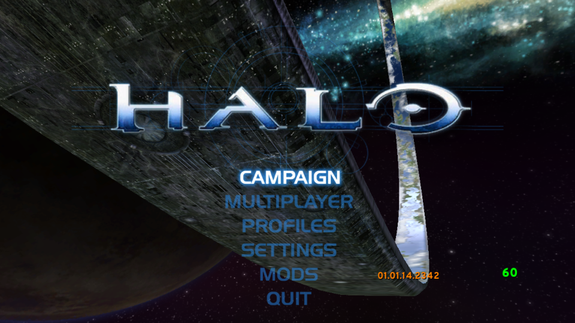

# OpenCE-WiiU

**Halo: Combat Evolved for the Nintendo Wii U**

Captured on a Wii U during development.

OpenCE-WiiU is Halo: Combat Evolved running natively on the Wii U. It is built on
[OpenCE](https://github.com/OpenCommunityEdition/OpenCE), the open source port of the
Halo CE decompilation, and it is not an emulator. The game's own code is compiled for
the console, with a renderer written for the Wii U's GPU, so it can use the GamePad,
the TV and the Wii U's controllers directly. You can play the campaign, play split
screen, and join online games.

It is a fan project and it is still experimental, but it is playable. In our longest
test, 24 minutes with six online games, it averaged about 56 frames a second and did
not crash.

A capture from a development build. [Capture details](docs/assets/screenshots/README.md).

## What you need

- A Wii U running [Aroma](https://aroma.foryour.cafe/), the homebrew environment.
- An SD card with about 4 GB free.
- Your own copy of Halo: Combat Evolved for the original Xbox, as a disc image
  (`.iso` or `.xiso`).
- A Windows PC or a Mac to prepare the card. Linux works too.

The game does not include any Halo files. The maps come from your own disc image and
are converted on your computer. Nothing is uploaded anywhere.

## Install

1. Download `opence-wiiu.zip` from the [latest release](https://github.com/Roastedd/OpenCE-WiiU/releases/latest) and unzip it.
2. Install [Python](https://www.python.org/downloads/) 3.10 or newer if you do not have it.
   (On a Mac, use the installer from python.org.)
3. Open the setup program. On Windows, double-click `Setup Wii U.bat`. On a Mac,
   double-click `Setup Wii U.command` (the first time, Control-click it, choose Open and
   confirm). Pick your Xbox ISO and your SD card, then press Prepare SD card.
4. When it says it is done, eject the card, put it in the Wii U and start OpenCE-U from
   the Wii U Menu.

That is the whole setup. The program copies the game to `sd:/wiiu/apps/halo/`, converts
your maps (a few minutes), finds the card by itself when only one Wii U card is plugged
in, and tidies the `._` files a Mac leaves on a card. To update the game later, run it
again with the new download and leave the ISO empty: your maps and saves stay as they are.

If something looks wrong, run `python3 setup_wiiu.py --check`. It lists what is on the card
and what is missing, and changes nothing. The [setup guide](docs/ISO_SETUP.md) has the Mac
details (formatting the card, the first open) and the command line options.

The first time the game starts it builds some cache files, so it takes longer than usual.
Your saves are in `wiiu/apps/halo/data/`; back that folder up before changing builds.

## Features

**Single player**
- The campaign, with checkpoints, and saves on the SD card.
- Co-op campaign for two players, and split screen multiplayer for two players.
- Play on the TV or the GamePad; the GamePad can show player 1's own view while the TV is split.
- Hold B, + or a finger on the touch screen for a second to skip a cutscene.

**Multiplayer**
- A server browser, internet games (the game uses UPnP to open the port), and system
  link on your own network.
- Hosting a game from the Wii U, and large games of 24 players or more.
- Voice chat through the GamePad's microphone or a headset in its jack.
- Halo Custom Edition maps from your PC copy. If you join a game that uses a map you do
  not have, the game downloads it from the host.

**Controllers**
- The GamePad and Pro Controller, with the buttons where the Xbox's are, and the touch
  screen in the menus.
- A Wii Remote with a Nunchuk, with a pointer and Wii Remote Plus motion aiming.
- Gyro aiming on the GamePad.
- Classic Controllers and, through Bloopair, other pads for the extra split screen players.

**Picture and speed**
- Graphics modes: Balanced (720 lines at 60 frames a second, the default), Performance,
  Quality (up to 1080 lines at 30, with dynamic resolution) and Custom.
- Resolution from 480 to 1080 lines, smooth motion (a frame for every refresh of the TV
  instead of 30 a second), and switches for grass, decals, particles, object shadows, lens
  flares, specular shine and bump mapping.
- Auto detail: when frames start to run long, the game leaves out small and far extras a
  step at a time and puts them back when there is room. The game itself plays the same.
- A performance overlay (L + R + -) with a short strip and a detailed panel.
- The community's high-resolution menu and HUD redraws (see the credits).

Not tested yet: split screen with three or four players. Bots, friends and parties, the
players page, a keyboard on the GamePad and automatic updates are in the code but switched
off for now.

## Controls

| Action | GamePad / Pro Controller |
| --- | --- |
| Move / look | Left stick / right stick |
| Fire / grenade | ZR / ZL |
| Jump / melee | B / A |
| Reload, use / switch weapon | Y / X |
| Flashlight / switch grenade | L / R |
| Crouch / zoom | Left stick click / right stick click |
| Pause | + |
| Performance overlay | L + R + - |

In menus, A selects and B goes back, and the touch screen works too. The
[player guide](port/wiiu/PLAYING.md#controls) has every control, the Wii Remote layout and the
gyro settings, and explains the settings in `config.toml`.

## Online play

This version uses network protocol 41. It can join games hosted by other protocol 41 builds,
but not games from newer OpenCE builds, which use protocol 44, and most public servers have
moved to 44. A game that is not on protocol 41 is left out of the server browser (Settings,
Network Setup, Server Browser has a Show incompatible row that lists them greyed out), so
the list can be short or empty. Support for protocol 44 is being worked on. How smooth a game
is depends on the map, the host and how many people are in it.

If you cannot connect:

- **The list is empty.** Most public servers are on protocol 44 now, so this version may genuinely find none. Otherwise check that the console is online (the Wii U's own network test
  should pass), and give the server browser a few seconds before giving up. A console whose
  clock has reset to an old date still works: the game does not depend on it.
- **The server uses a map you do not have.** The game downloads it from the host, into
  `wiiu/apps/halo/data/custom_maps`. The first one can be 100 to 250 MB, because it also
  brings Halo Custom Edition's `bitmaps.map`, `sounds.map` and `loc.map`. The card needs
  that much free space, and the host has to allow downloads. If you own Halo Custom Edition
  or the Master Chief Collection on a PC, you can copy those three files into the same
  folder yourself, from its `maps` folder.
- **It says the version is different.** The other side is on another network version; one of
  you needs to update.
- **Still stuck.** Open an issue and attach `wiiu/apps/halo/log.txt` from the card right
  after the attempt. Its lines starting with `Internet play:` and `Net:` say where it stopped.

## Updates

The game checks for a newer version each time it starts, when the console is online. If one
is out, a panel at the main menu offers it: **A** downloads and installs it (about 18 MB) and
restarts the game, **B** asks again next time. Saves, settings and maps are never touched, and
if the new version does not reach its main menu the old one is put back. To turn the check
off, use Settings, your profile, Network Setup, Check for updates. The first version with
this check is build 1; older versions have to be replaced by hand once.

## Questions

**Does my Wii U need to be modded?** It needs Aroma, which loads homebrew apps from the SD
card. Nothing is installed to the console's own storage.

**Which Halo do I need?** The original Xbox release of Halo: Combat Evolved. The PC release,
Custom Edition, Anniversary and the Master Chief Collection are different formats and will
not work with the setup.

**Why can't I just download the maps?** They belong to Microsoft, so this project can't hand
them out. Converting your own copy on your own computer gets around that.

**It won't start, or the maps are missing.** Run `python3 setup_wiiu.py --check` and fix
whatever it marks with FIX. The usual causes are a `shaders.pack` that does not match the
`halo.wuhb`, and an SD card that is not formatted as FAT32 (the Mac section of the
[setup guide](docs/ISO_SETUP.md#on-a-mac) shows how to format one).

**Will it run at 60 fps?** Mostly it sits between 50 and 60 in our tests. The biggest fights
and some online games dip lower, so it is not a locked 60 yet. The overlay (L + R + -) shows
what the game is doing.

**I found a bug.** Open an [issue](https://github.com/Roastedd/OpenCE-WiiU/issues) with the
build, the map, your controller and what happened. Include the logs the
[player guide](port/wiiu/PLAYING.md) describes, after reading them for anything personal.

## How well does it work?

This repository starts from rc1, the source tag
[`wiiu-rc1-source`](https://github.com/Roastedd/OpenCE-WiiU/tree/wiiu-rc1-source). In a
24-minute session on a console it joined six online games with no freeze or crash and exited
normally. Five-second windows averaged 55.9 FPS. The [per-map results and checksums](VALIDATION.md)
are in the repository.

Since then drawing is lighter in busy scenes, the game steps detail down sooner when a frame
runs late, and Save and Quit no longer freezes the screen while the saved game is written.
Blood Gulch solo went from about 49 to about 59 frames a second in the same tests.

It is still experimental. We have not tested finishing the whole campaign.

## Building and contributing

[Build instructions](BUILDING-WIIU.md) cover the Docker toolchain and checks that need no game
files. The app icon and start-up pictures can be redrawn with `python3 tools/wiiu_app_art.py`,
and the download bundle is made with `python3 tools/wiiu/package_setup.py --app FOLDER`.

The original [upstream overview](README.upstream.md) is kept for reference. Its platform claims
and downloads describe upstream OpenCE. Publishing workflows inherited from it are archived
under `.github/upstream-workflows/`, and this repository's Wii U releases are managed separately.

## Credits

The decompilation is of the Xbox build 2342 (`cachebeta.exe`, SHA-256
`4cc87b45f721270392a96f1674ed2b5cd4a7bb4355faeab4531d1cf1884d9520`).
OpenCE starts from the decompilation of
[bnunu/halo-1](https://github.com/bnunu/halo-1), which is a fork of
[punpckhdq/halo](https://github.com/punpckhdq/halo). The artists of the
high-res redraws are in [AUTHORS.md](AUTHORS.md). The main contributors are Jonas Volman (@bnunu) and MrBruh (@cybersecurity). Everyone else who has contributed is on the
[contributors page](https://github.com/OpenCommunityEdition/OpenCE/graphs/contributors).

## Licence

OpenCE is free software: you can give it to others and change it under the
terms of the GNU Affero General Public License as published by the Free
Software Foundation, version 3 of the License or (at your option) any later
version (`AGPL-3.0-or-later`). It comes with no warranty. The full text is in
[LICENSE](LICENSE).

- **From the change.** The AGPL applies from the commit that made the change,
  and to each release built from that commit or a later one. Earlier
  releases, and the source at every earlier commit, were released under
  [CC0 1.0](LICENSES/CC0-1.0.txt) and stay that way.
- **What OpenCE builds on.** The decompilation of
  [punpckhdq/halo](https://github.com/punpckhdq/halo) is under the AGPL 3.0
  from 17 October 2026, and under CC0 1.0 before that date.
  [bnunu/halo-1](https://github.com/bnunu/halo-1) is under CC0 1.0.
- **Contributions** are under `AGPL-3.0-or-later`. A change taken from a
  project under GPL 3.0 keeps that licence and its notices; the GPL 3.0 and
  the AGPL 3.0 let the two be combined (section 13 of each).
- **Hosts and servers.** If you change the game and let other persons play
  with your version over a network (for example, as the host of an internet
  game, or on a web site), the AGPL asks you to offer them the source of
  your version (section 13). This Wii U version has its source in this repository; each published
  binary release must identify its matching source commit or tag.
- **Third-party code, fonts and art** keep their own licences, which are
  next to them (`port/third_party`, `port/assets/fonts`,
  `port/assets/icons`, `port/assets/text_filter`). The release downloads and
  the web site's `licenses.txt` carry their notices.
- **Halo is not covered.** The licence covers the work of OpenCE's authors.
  It gives no rights in Halo, its maps or anything else that Microsoft owns.

## Disclaimer
OpenCE (Open Community Edition) is an unofficial fan project. It is not endorsed by or affiliated with Microsoft, Xbox Game Studios, Halo Studios, Activision or Bungie. Halo and Halo: Combat Evolved are trademarks of Microsoft Corporation; Halo © Microsoft Corporation.
No game data is included. You must provide your own copy of the game.
