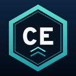

<div align="center">



# OpenCE-WiiU

**Halo: Combat Evolved, running natively on your Wii U.**

[](port/wiiu/PLAYING.md)
[](VALIDATION.md)
[](#online-play)
[](LICENSE)

[**Get started**](#installing) ·
[Features](#what-it-does) ·
[Controls](#controls) ·
[Build](BUILDING-WIIU.md) ·
[Report a problem](https://github.com/Roastedd/OpenCE-WiiU/issues) ·
[Credits](#credits)


<sub>Captured on Wii U during development. Maintained by <a href="https://github.com/Roastedd">Roastedd</a>, built on <a href="https://github.com/OpenCommunityEdition/OpenCE">OpenCE</a>.</sub>

</div>

> [!IMPORTANT]
> **Bring your own game.** No maps or disc image are included. You need
> Halo: Combat Evolved for the **original Xbox**. This is an unofficial fan
> port, with no affiliation to Microsoft or the game's creators.

## What it does

| | |
| --- | --- |
| **Campaign on Wii U** | The original game's code, compiled for the Wii U with a native GX2 renderer. |
| **Online multiplayer** | Server browser, internet games, and system link with compatible protocol 41 hosts. |
| **TV and GamePad** | Play on the TV or GamePad, with touch input in the menus. |
| **Wii U controls** | GamePad, Pro Controller, and Wii Remote/Nunchuk support, including gyro options. See the player guide for controller details. |
| **Graphics options** | Resolution, smooth motion, graphics presets, and a performance overlay. |
| **Your own maps and saves** | Game data and saves stay on your SD card. Custom Edition support is described in the player guide. |


<sub>Hardware capture from a development build. Screenshots show the port in use; they do not qualify every mode or map. [Capture details](docs/assets/screenshots/README.md).</sub>

## Installing

**Source is available now. A complete downloadable rc1 bundle has not been published yet.**
When packaged, downloads will be on this repository's
[Releases page](https://github.com/Roastedd/OpenCE-WiiU/releases).

You need Aroma, an SD card with roughly 4 GB free for the converted maps
and caches, and your own Xbox copy of Halo. The app and maps go here:

```text
sd:/wiiu/apps/halo/
├── halo.wuhb
├── shaders.pack
├── brokers.txt
└── data/
    └── maps/
        ├── ui.map
        ├── a10.map
        └── …the remaining converted Xbox maps
```

1. Get the matching `halo.wuhb`, `shaders.pack`, and `brokers.txt` from the
   release bundle. The application and shader pack belong together.
2. Open **`Setup Wii U.bat`** (Windows) or **`Setup Wii U.command`**
   (macOS), choose your Xbox ISO and SD card, and select **Convert maps on
   this computer**. This helper requires Python 3.10 or later and runs locally.
   [Both setup methods →](docs/ISO_SETUP.md)

3. The helper extracts and converts all maps into `wiiu/apps/halo/data/maps/`.
   If you prefer manual conversion, the [player guide](port/wiiu/PLAYING.md)
   retains those instructions.
4. Start **OpenCE-U** from the Wii U Menu.

The [full player guide](port/wiiu/PLAYING.md) covers map extraction,
controller setup, settings, and troubleshooting. Keep a backup of `data/`
before changing builds: it contains your saves.

### Can I just drop in an ISO?

**On a computer: yes.** The setup helper reads your ISO, extracts the maps,
converts them and puts them on the SD card. There is no separate extraction
step. It can also copy and split the ISO for later console import.

**On the Wii U: a new importer build is under development.** It detects
`halo.iso` at first launch and prepares the maps before starting the game.
Its converter has passed host tests, but the setup screen and full first-run
flow still need a hardware trial. The original rc1 executable does not gain
this feature from an icon update. [Instructions and validation →](docs/ISO_SETUP.md)

FAT32 limits each file to less than 4 GiB; the helper splits large full-disc
images automatically when **Copy ISO for import on Wii U** is selected.

## Controls

| Action | GamePad / Pro Controller |
| --- | --- |
| Move / look | Left stick / right stick |
| Fire / grenade | ZR / ZL |
| Jump / melee | B / A |
| Reload, use / switch weapon | Y / X |
| Flashlight / switch grenade | L / R |
| Crouch / zoom | Left stick click / right stick click |
| Pause | + |
| Performance overlay | L + R + − |

In menus, **A selects and B goes back**. The touch screen selects items too.
[All controls and gyro settings →](port/wiiu/PLAYING.md#controls)

## Online play

rc1 uses **network protocol 41**. It cannot join protocol 44 games from
newer OpenCE builds. You need a compatible host; a visible server is not
necessarily compatible. Performance depends on the map, host, and player
count.

## Status and testing

This repository starts from **rc1**, source tag
[`wiiu-rc1-source`](https://github.com/Roastedd/OpenCE-WiiU/tree/wiiu-rc1-source).
It completed a 24-minute hardware session with **six online joins**, no
recorded freeze or crash, and a normal exit. Recorded five-second windows
averaged **55.9 FPS**. [Per-map results and checksums →](VALIDATION.md)

The port is still experimental. Full campaign completion, every controller
configuration, split screen, and long co-op sessions have not all been
qualified. The newer upstream merge has separate join problems and is not
this baseline.

If something goes wrong, open an [issue](https://github.com/Roastedd/OpenCE-WiiU/issues)
with the build, map, controller, and what happened. Include the logs described
in the player guide, and review them for personal information before posting.

## Building and contributing

[Build instructions](BUILDING-WIIU.md) include the Docker toolchain and
asset-free checks. The application icon can be regenerated with
`python3 tools/wiiu_app_art.py`; the original helmet tile is restored.

The original [upstream overview](README.upstream.md) is kept for reference.
Its platform claims and downloads describe upstream OpenCE. Inherited
publishing workflows are archived under `.github/upstream-workflows/`;
this repository's Wii U releases are managed separately.

## Credits

The decompilation is of the Xbox build 2342 (`cachebeta.exe`, SHA-256
`4cc87b45f721270392a96f1674ed2b5cd4a7bb4355faeab4531d1cf1884d9520`).
OpenCE starts from the decompilation of
[bnunu/halo-1](https://github.com/bnunu/halo-1), which is a fork of
[punpckhdq/halo](https://github.com/punpckhdq/halo). The artists of the
high-res redraws are in [AUTHORS.md](AUTHORS.md). The main contributors are Jonas Volman (@bnunu) and MrBruh (@cybersecurity). Everyone else who has contributed is on the
[contributors page](https://github.com/OpenCommunityEdition/OpenCE/graphs/contributors).

## Licence

OpenCE is free software: you can give it to others and change it under the
terms of the GNU Affero General Public License as published by the Free
Software Foundation, version 3 of the License or (at your option) any later
version (`AGPL-3.0-or-later`). It comes with no warranty. The full text is in
[LICENSE](LICENSE).

- **From the change.** The AGPL applies from the commit that made the change,
  and to each release built from that commit or a later one. Earlier
  releases, and the source at every earlier commit, were released under
  [CC0 1.0](LICENSES/CC0-1.0.txt) and stay that way.
- **What OpenCE builds on.** The decompilation of
  [punpckhdq/halo](https://github.com/punpckhdq/halo) is under the AGPL 3.0
  from 17 October 2026, and under CC0 1.0 before that date.
  [bnunu/halo-1](https://github.com/bnunu/halo-1) is under CC0 1.0.
- **Contributions** are under `AGPL-3.0-or-later`. A change taken from a
  project under GPL 3.0 keeps that licence and its notices; the GPL 3.0 and
  the AGPL 3.0 let the two be combined (section 13 of each).
- **Hosts and servers.** If you change the game and let other persons play
  with your version over a network (for example, as the host of an internet
  game, or on a web site), the AGPL asks you to offer them the source of
  your version (section 13). This Wii U version has its source in this repository; each published
  binary release must identify its matching source commit or tag.
- **Third-party code, fonts and art** keep their own licences, which are
  next to them (`port/third_party`, `port/assets/fonts`,
  `port/assets/icons`, `port/assets/text_filter`). The release downloads and
  the web site's `licenses.txt` carry their notices.
- **Halo is not covered.** The licence covers the work of OpenCE's authors.
  It gives no rights in Halo, its maps or anything else that Microsoft owns.


## Disclaimer
OpenCE (Open Community Edition) is an unofficial fan project. It is not endorsed by or affiliated with Microsoft, Xbox Game Studios, Halo Studios, Activision or Bungie. Halo and Halo: Combat Evolved are trademarks of Microsoft Corporation; Halo © Microsoft Corporation.
No game data is included. You must provide your own copy of the game.
